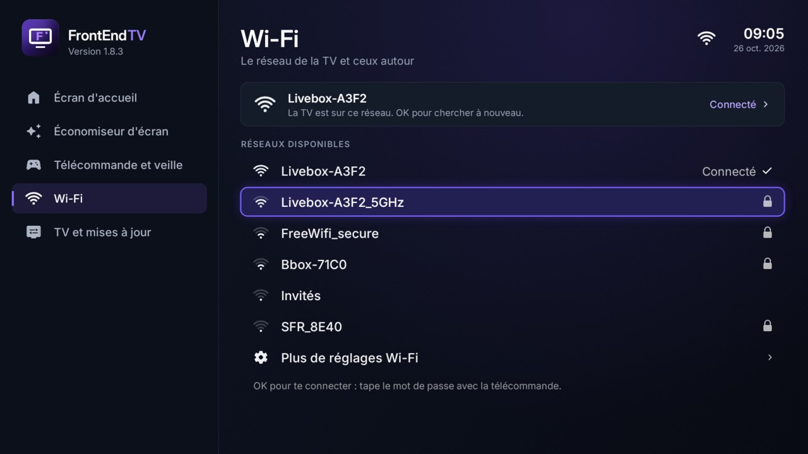
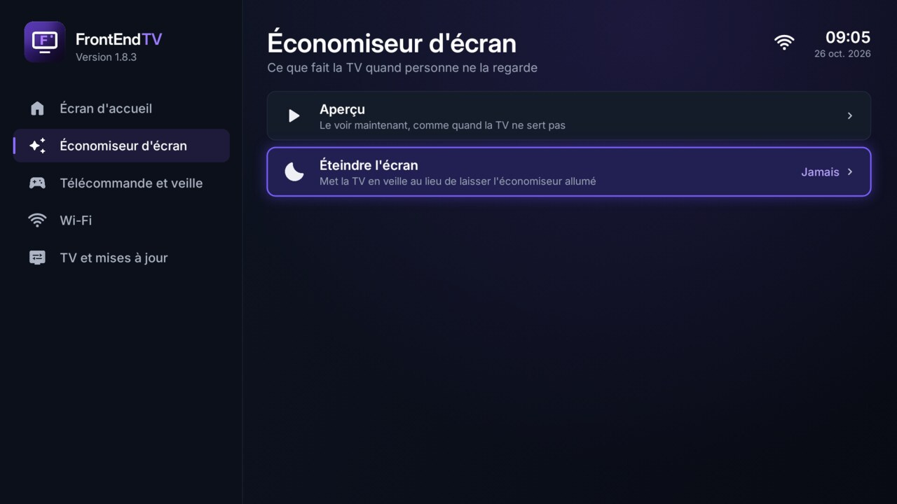
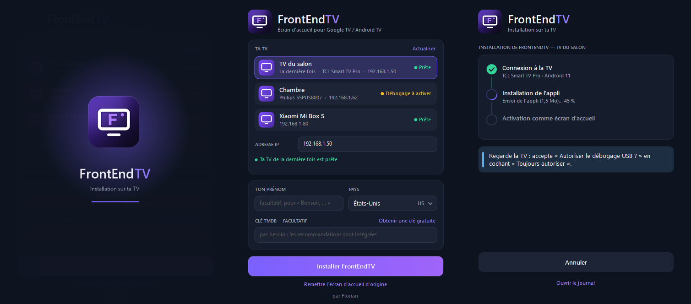

# FrontEndTV

**Un écran d'accueil moderne, sombre et fluide pour les TV Android TV et Google TV.**
Développé par Florian.


## Ce que ça fait

- **Accueil épuré** : l'heure, un message d'accueil, la date et la météo, puis des recommandations de films et séries
  disponibles sur tes applis (onglets *Pour toi*, *Films*, *Séries*), avec le fond qui suit la carte sélectionnée.
- **Dock d'applis** en verre translucide, avec les vrais logos (Netflix, YouTube, Prime Video, Disney+…).
- **Tiroir du bas** : entrées HDMI, *Toutes les apps*, réglages, et la météo heure par heure.
- **Bouton TV** bien visible en haut : la sélection s'y place à l'ouverture, pour passer à la télé d'un appui.
  L'heure change avec une petite animation à chaque minute.
- **Réglages de la TV** en un clic (l'engrenage en haut à droite).
- **Touches de la télécommande** (Netflix, YouTube…) : reconnues toutes seules, même sur les marques que FrontEndTV ne
  connaît pas (Philips…), et réglables pour ouvrir l'appli de ton choix.
- Pensé pour les petites puces des TV : animations calées sur l'écran, seules les zones qui bougent sont redessinées.
- Retire les applis publicitaires du constructeur (sans les désinstaller) et remplace l'économiseur d'écran.
  Tout revient comme avant en un clic (*Écran d'accueil* → *Original*).

| Toutes les apps | Réglages de FrontEndTV |
|---|---|
|  |  |

### Les réglages de FrontEndTV

Rangés par catégories à gauche (*Écran d'accueil*, *Économiseur d'écran*, *Télécommande et veille*, *Wi-Fi*,
*TV et mises à jour*) : à droite, seulement ceux de la catégorie choisie, chacun avec une phrase qui dit à quoi il sert.

- **Wi-Fi** : le réseau de la TV et ceux autour ; OK sur un réseau, puis le mot de passe tapé à la télécommande
  (Android 11 ou plus récent). L'icône Wi-Fi en haut à droite y mène aussi.
- **Économiseur d'écran → Éteindre l'écran** : la TV se met en veille au lieu de laisser l'économiseur allumé
  (tout de suite, ou après 5, 10, 15, 30 min ou 1 h).
- **Minuterie de veille**, applis du dock, boutons du haut, langue, météo, photos…

| Wi-Fi | Économiseur d'écran |
|---|---|
|  |  |

## Installation automatique (Windows, 5 minutes)

Il faut une **Google TV ou Android TV** (Android 8 ou plus récent) et un **PC Windows** sur le même Wi-Fi.

1. **Sur la TV** (une seule fois)
   - *Paramètres → Système → À propos* : appuie **7 fois** sur *Build* (message « Vous êtes développeur »).
   - *Paramètres → Système → Options pour les développeurs* : active **Débogage USB**.
2. **Sur le PC** : télécharge **`FrontEndTV-Installateur.exe`** dans [Releases](../../releases). Un seul fichier,
   rien d'autre à installer.
3. Double-clique dessus. Il fait tout, seul (tu peux remplir ton prénom, ton pays et ta clé TMDB avant que ça démarre) :
   - **liste les TV de ton réseau** avec leur nom, leur marque et leur modèle, et dit si chacune est *Prête* ou s'il
     faut encore activer le débogage ; il choisit seul celle de la dernière fois (ou la seule prête) et
     **démarre l'installation automatiquement** après quelques secondes ;
   - parle directement à la TV : rien d'autre à télécharger ni à installer, même pas les outils Android ;
   - installe l'appli (ou la met à jour ; rien à faire si elle est déjà à jour), envoie ton prénom et ton pays
     (facultatifs) ;
   - **active FrontEndTV comme écran d'accueil**, attend la confirmation et l'ouvre sur la TV.

   Sur la TV, accepte **« Autoriser le débogage USB ? »** en cochant *Toujours autoriser* : une fois pour le PC, et
   la première fois une seconde pour FrontEndTV. L'installateur te dit quand.



> Windows peut afficher « Windows a protégé votre ordinateur » (l'installateur n'est pas signé) : *Informations
> complémentaires → Exécuter quand même*. L'installateur a besoin d'Internet la première fois : il télécharge l'appli
> depuis la page de sa version et vérifie qu'elle est intacte.

> Sur Android 14, Google Play Protect peut afficher « Appli à risque bloquée » : *Plus de détails → Installer quand même*.
> Sur une Chromecast avec Google TV (Android 14), active aussi *Débogage sans fil* dans les options pour les développeurs.

### Les recommandations (intégrées, sans clé)

Rien à faire : chaque jour, GitHub prépare la liste des films et séries tendance et des nouveautés de chaque service
(Netflix, Prime Video, Disney+…) pour chaque pays, et la TV lit celle de ton pays. Elle ne garde que ce qui est sur
les applis installées.

Une clé TMDB à toi reste possible (facultatif) : la TV demande alors elle-même à TMDB. Gratuite : crée un compte sur
[themoviedb.org](https://www.themoviedb.org/signup), puis [Paramètres → API](https://www.themoviedb.org/settings/api) ;
colle le *Jeton d'accès en lecture à l'API* (ou la *Clé d'API*) dans l'installateur. Elle reste sur ta TV.

Pour changer de clé, de pays ou de prénom plus tard, relance simplement l'installateur (clé vide : la TV garde la sienne).

## Mettre à jour

Sur la TV : ouvre **FrontEndTV** (l'engrenage de l'accueil) → **TV et mises à jour** → **Mise à jour**. S'il y a une
nouvelle version, elle est affichée (avec un point orange à côté de la catégorie) ; **OK** la télécharge et l'installe
toute seule. FrontEndTV vérifie aussi de lui-même toutes les 30 minutes.

## Revenir en arrière

Relance l'installateur et clique sur **Remettre l'écran d'accueil d'origine**, ou sur la TV : **FrontEndTV → Écran d'accueil → Original**. L'accueil d'origine, l'économiseur et toutes les
applis désactivées reviennent exactement comme avant. Pour désinstaller : passe d'abord sur *Original*, puis
*Paramètres → Applications → FrontEndTV → Désinstaller*.

## Compiler soi-même

Il faut un JDK 17+, les outils Android en ligne de commande (build-tools 36 conseillé, platform android-34) et adb.
Sous Windows, utilise Git Bash ou WSL.

```bash
./build.sh                 # le 1er lancement crée config.properties : règle-le, puis relance
adb connect 192.168.1.50:5555
adb install -r FrontEndTV.apk
```

Sous Windows, `build.sh` crée aussi **`FrontEndTV-Installateur.exe`** grâce au compilateur C# fourni avec Windows ;
ailleurs, il faut Mono (`mcs`). L'installateur prend `FrontEndTV.apk` à côté de lui, ou télécharge celui de sa version
et vérifie son empreinte. Son code est dans `installer/` (`Adb.cs` : son propre client ADB, pour ne dépendre d'aucun
outil externe ; `Discovery.cs` : la recherche des TV).

- `config.properties` (clé TMDB, ville, pays, prénom…) et `freemytv.keystore` (la clé de signature créée au premier
  build) restent sur ton PC : ils sont exclus de Git. **Garde `freemytv.keystore`** : les mises à jour doivent être
  signées avec la même clé, sinon il faut désinstaller avant de réinstaller.
- Les textes sont dans `app/assets/i18n/`, les applis du dock dans `SHELF` (`app/src/io/freemytv/HomeApps.java`),
  l'accueil dans `HomeView.java`.
- Les recommandations intégrées : `tools/make_recs.py`, lancé chaque jour par `.github/workflows/recs.yml` avec la
  clé TMDB gardée dans le secret `TMDB_KEY` du dépôt ; les fichiers par pays sont sur la branche `recos`.

## Crédits

- **FrontEndTV** : conçu et développé par Florian.
- Recommandations : [TMDB](https://www.themoviedb.org) — ce produit utilise l'API TMDB sans être approuvé ni certifié
  par TMDB. Météo : [Open-Meteo](https://open-meteo.com). Police : [Inter](https://rsms.me/inter/) (OFL).

## Licence

MIT — voir [LICENSE](LICENSE).
