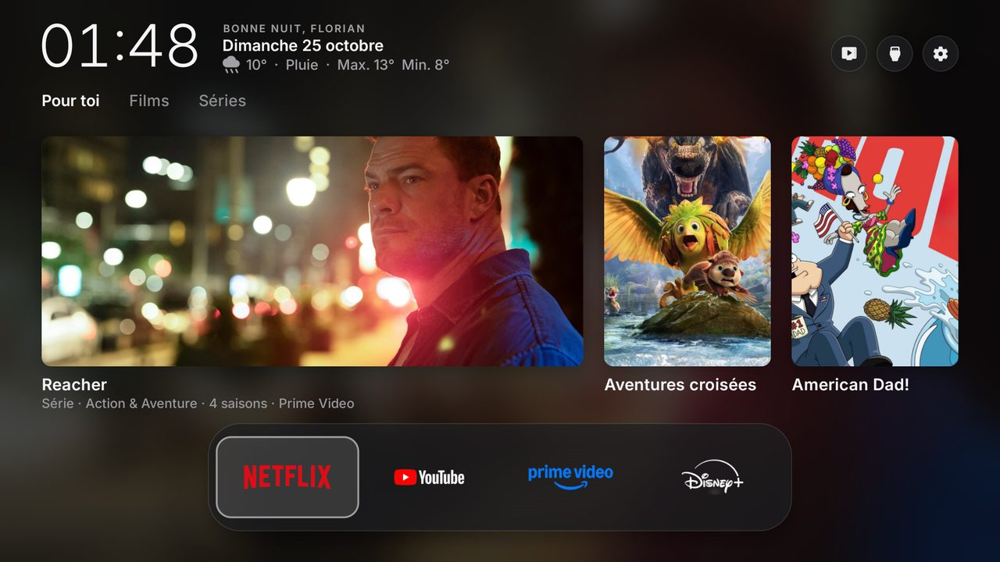
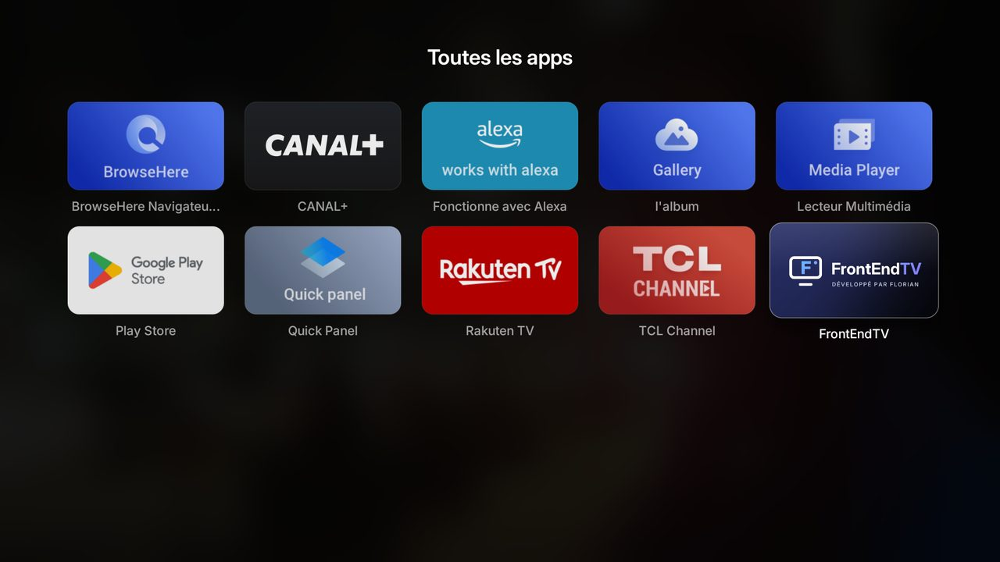
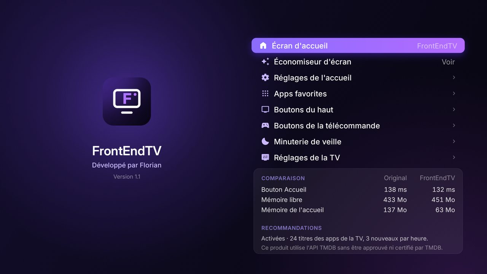

# FrontEndTV

**Un écran d'accueil moderne, sombre et fluide pour les TV Android TV et Google TV.**
Développé par Florian, à partir du projet libre [Free My TV](https://github.com/simbasjungles/free-my-tv) (licence MIT).



## Ce que ça fait

- **Accueil épuré** : l'heure, un message d'accueil, la date et la météo, puis des recommandations de films et séries
  disponibles sur tes applis (onglets *Pour toi*, *Films*, *Séries*), avec le fond qui suit la carte sélectionnée.
- **Dock d'applis** en verre translucide, avec les vrais logos (Netflix, YouTube, Prime Video, Disney+…).
- **Tiroir du bas** : entrées HDMI, *Toutes les apps*, réglages, et la météo heure par heure.
- **Réglages de la TV** en un clic (l'engrenage en haut à droite).
- Pensé pour les petites puces des TV : animations calées sur l'écran, seules les zones qui bougent sont redessinées.
- Retire les applis publicitaires du constructeur (sans les désinstaller) et remplace l'économiseur d'écran.
  Tout revient comme avant en un clic (*Écran d'accueil* → *Original*).

| Toutes les apps | Réglages |
|---|---|
|  |  |

## Installation automatique (Windows, 5 minutes)

Il faut une **Google TV ou Android TV** (Android 8 ou plus récent) et un **PC Windows** sur le même Wi-Fi.

1. **Sur la TV** (une seule fois)
   - *Paramètres → Système → À propos* : appuie **7 fois** sur *Build* (message « Vous êtes développeur »).
   - *Paramètres → Système → Options pour les développeurs* : active **Débogage USB**.
2. **Sur le PC** : télécharge la dernière version dans [Releases](../../releases) :
   `FrontEndTV.apk`, `Installer-FrontEndTV.bat` et `installer.ps1`, dans le même dossier.
3. Double-clique sur **`Installer-FrontEndTV.bat`**. Il fait tout :
   - télécharge les outils Android de Google si besoin ;
   - **trouve la TV tout seul** sur le Wi-Fi (sinon il demande son adresse IP) ;
   - installe l'appli, demande (facultatif) ton prénom, ton pays et ta clé TMDB ;
   - **active FrontEndTV comme écran d'accueil** et vérifie que c'est fait.

   Sur la TV, accepte deux fois **« Autoriser le débogage USB ? »** en cochant *Toujours autoriser* : une fois pour le
   PC, une fois pour FrontEndTV.

> Sur Android 14, Google Play Protect peut afficher « Appli à risque bloquée » : *Plus de détails → Installer quand même*.
> Sur une Chromecast avec Google TV (Android 14), active aussi *Débogage sans fil* dans les options pour les développeurs.

### La clé TMDB (pour les recommandations)

Gratuite : crée un compte sur [themoviedb.org](https://www.themoviedb.org/signup), puis
[Paramètres → API](https://www.themoviedb.org/settings/api) et demande une clé développeur. Copie le
*Jeton d'accès en lecture à l'API* (ou la *Clé d'API*) quand l'installateur la demande. Elle reste sur ta TV.
Sans clé, l'accueil fonctionne, sans les recommandations.

Pour changer de clé, de pays ou de prénom plus tard, relance simplement l'installateur.

## Revenir en arrière

Relance l'installateur et choisis **[2]**, ou sur la TV : **FrontEndTV → Écran d'accueil → Original**. L'accueil d'origine, l'économiseur et toutes les
applis désactivées reviennent exactement comme avant. Pour désinstaller : passe d'abord sur *Original*, puis
*Paramètres → Applications → FrontEndTV → Désinstaller*.

## Compiler soi-même

Il faut un JDK 17+, les outils Android en ligne de commande (build-tools 34 ou plus, platform android-34) et adb.
Sous Windows, utilise Git Bash ou WSL.

```bash
./build.sh                 # le 1er lancement crée config.properties : règle-le, puis relance
adb connect 192.168.1.50:5555
adb install -r FrontEndTV.apk
```

- `config.properties` (clé TMDB, ville, pays, prénom…) et `freemytv.keystore` (la clé de signature créée au premier
  build) restent sur ton PC : ils sont exclus de Git. **Garde `freemytv.keystore`** : les mises à jour doivent être
  signées avec la même clé, sinon il faut désinstaller avant de réinstaller.
- Les textes sont dans `app/assets/i18n/`, les applis du dock dans `SHELF` (`app/src/io/freemytv/HomeApps.java`),
  l'accueil dans `HomeView.java`.

## Crédits

- **FrontEndTV** : design, accueil natif fluide, recommandations et identité visuelle par Florian.
- Basé sur **[Free My TV](https://github.com/simbasjungles/free-my-tv)** (© Free My TV contributors, licence MIT).
- Recommandations : [TMDB](https://www.themoviedb.org) — ce produit utilise l'API TMDB sans être approuvé ni certifié
  par TMDB. Météo : [Open-Meteo](https://open-meteo.com). Police : [Inter](https://rsms.me/inter/) (OFL).

## Licence

MIT — voir [LICENSE](LICENSE).
